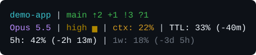
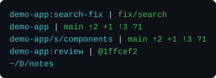
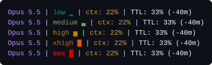
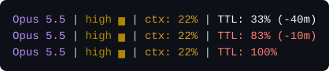
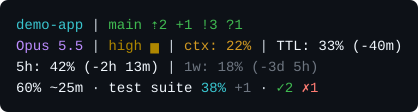
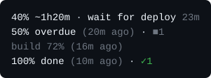
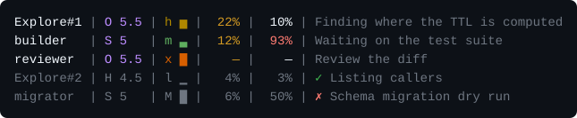
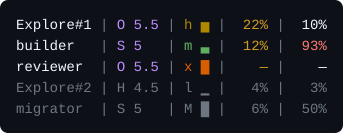

# claude-shared

Shared [Claude Code](https://claude.com/claude-code) environment settings, synced
across machines via this git repo.

**What it's for.** Keeping a single source of truth for the parts of a Claude Code
setup that should be identical on every machine — the colored status line, a few
core `settings.json` keys, and a set of reusable skills — instead of hand-copying
dotfiles around.

**What it does.** `./sync.sh` deploys those pieces into `~/.claude` on whatever
machine you run it from: it's idempotent, merges rather than overwrites (so
machine-specific config is preserved), and backs up `settings.json` first. Clone
the repo on a new machine, run `sync.sh` once, and that machine's Claude
environment matches the others — after which you can manage everything from inside
Claude Code via the `/claude-shared` skill. See **What `sync.sh` writes** below for
the exact set of changes it makes.

**Read the shared settings before you sync.** The keys in
`claude/settings.shared.json` (`model`, `effortLevel`, `enabledPlugins`) are the
maintainer's personal preferences, and `sync.sh` copies them onto every machine
that runs it — over whatever you had set. Fork the repo and edit that file to
your own taste before running it. `settings.json` is backed up before the merge;
`CLAUDE.md` is not (only the text between the managed-block markers changes, but
there is no copy to restore from).



## Features

- [**The status line**](#the-status-line) — three colored lines under the
  prompt: where you are in git, what the session runs on and how much of it is
  left, and your quota windows.
  - [Location](#location) — repo name, worktree, subfolder and git state.
  - [Effort](#effort) — the effort level as a color and a bar.
  - [The cache clock](#the-cache-clock) — how long the prompt cache has left.
  - [Quotas](#quotas) — the 5-hour and weekly windows with their countdowns.
  - [Progress](#progress) — the task's estimated progress and the real
    progress of long commands, on one line.
- [**The agent panel**](#the-agent-panel) — one row per live subagent, in the
  session line's columns and colors.
- [**The kill guard**](#the-kill-guard) — a hook that blocks commands which
  would kill every process you own (the desktop and every other session), and
  `pidjail`, which runs a test suite where even `kill -- -1` stays inside it.
- [**Shared skills**](#shared-skills) — symlinked into
  `~/.claude/skills/`: guided setup and sync, installers for per-repo skills,
  long-running and multi-agent work, PR review, token reporting, briefs,
  disk cleanup.
- [**Per-repo skill templates**](#per-repo-skill-templates) — `/handoff` and
  `/work-on-gh-issue`, filled in for a target repo by an installer skill.
- [**`sync.sh`**](#what-syncsh-writes) — one idempotent deploy for all of the
  above, plus a managed pointer block in `~/.claude/CLAUDE.md`.

## Set up on a new machine

```bash
git clone <this-repo-url> ~/projects/claude-shared
cd ~/projects/claude-shared
./sync.sh
```

Requires [`jq`](https://jqlang.github.io/jq/) (used to merge `settings.json`).
Restart Claude Code afterwards so the status line takes effect.

`sync.sh` also symlinks the shared skills into `~/.claude/skills/`, so from then
on you can manage everything from inside Claude Code by running **`/claude-shared`**
(guided), or `/sync-claude-env` to re-sync directly.

## The status line

`claude/statusline-command.sh` draws three lines, plus a progress line, the one
at the top of this README:

1. **Location** — the repo (cyan) and its branch with git state (green).
2. **Session** — the model (magenta), effort level, context used (yellow) and
   the cache clock. A field Claude Code sends nothing for drops out.
3. **Quotas** — the 5-hour window (white) and the weekly one (gray), each with
   the time until it resets. The whole line is shown only when Claude Code
   sends rate-limit data.
4. **Progress** — one line, only while there is something to show: the
   task's estimate and long-running jobs. See [Progress](#progress).

A trailing blank line keeps the status from gluing to the CLI chrome below it.
The script reads `$HOME` at runtime, so no paths are hardcoded, and it runs on
macOS's stock bash 3.2.

### Location



Inside git, the line names the repo rather than its path, so a long checkout
path never pushes the branch off the line:

- A **linked worktree** reads `repo:worktree`, naming the main repo it belongs
  to.
- A **subfolder** follows the repo name, abbreviated fish-style: every folder
  but the last cut to its first letter (two for a leading `.` or `_`, so hidden
  folders stay told apart).
- A **detached HEAD** shows `@` and the short commit id in place of a branch.
- **Outside git**, the whole path is abbreviated, with your home folder as `~`.

After the branch come p10k-style counts, each only when nonzero: `⇡N` commits
ahead of upstream, `⇣N` behind, `+N` staged, `!N` modified, `?N` untracked.

### Effort



Effort reads as a traffic light, cheap to costly, with a bar that carries the
level without color: `low ▁` teal, `medium ▃` green, `high ▅` amber, `xhigh ▇`
orange, `max █` bold red (and `ultra █` bold purple). The colors are fixed
256-color codes, so a terminal theme can't shift them. A level the table doesn't
know prints plain; the segment drops out for a model with no effort setting.

The session line also records its effort per session under
`~/.claude/cache/statusline-session-effort/`, for the agent panel: an agent whose
definition sets no effort runs at the session's, which only the session line is
told.

### The cache clock



A context is only cheap to come back to while its prompt cache is alive, and
that cache outlives the request that wrote it by a fixed TTL — five minutes for
a subagent, an hour for a main session. Past it the whole context is re-sent at
full price. So how full a context is only tells half the story; the other half
is how long it has been sitting there. The session line and every agent row
carry it.

`TTL` is the share of that window the silence since the last turn has spent,
and the countdown what is left of it. It renders white and turns red from 80%
on — the one signal worth a color change, in a hue no context percentage uses,
so no field reads as part of the one before it. Once the cache is gone the
percentage sticks at 100% and the countdown disappears.

Two things make the reading trustworthy rather than assumed:

- **The TTL is read, not hardcoded.** Every turn's `usage.cache_creation`
  reports which bucket it wrote — `ephemeral_5m_input_tokens` or
  `ephemeral_1h_input_tokens` — so the window comes from the transcript and
  survives the harness changing its mind. A turn that wrote no cache says
  nothing, so the search walks back to one that did; failing that it falls back
  to five minutes for an agent, an hour for a session.
- **The clock runs from the last assistant turn**, the last moment a request is
  *known* to have refreshed the cache. That reads conservatively on purpose: a
  turn still streaming hasn't been written yet, so a long one counts as silence
  until it lands. The cache is never claimed to be fresher than the transcript
  can prove.

Timestamps are converted with plain integer arithmetic rather than `date -d`,
which GNU and BSD spell differently.

Keeping the session's reading live needs a `refreshInterval` in the
`statusLine` block, which the shared `settings.json` sets to 15 seconds.
Without one the status line repaints only when the main loop moves, and a
session sitting idle is exactly when its TTL is running down. A second-by-second
cadence buys nothing over 15s: what it reports is silence, measured against a
window an hour long. The agent panel needs no such setting; the CLI re-runs
its command on its own timer while any agent row is showing.

### Quotas

The third line shows the share of each rate-limit window used and the time
until it resets: `-2h 13m` within a day, `-3d 5h` beyond. The 5-hour window is
the one you actively burn through, so it stays white; the slow-moving weekly
window renders gray to recede next to it.

The script also keeps the last reading on disk, for tools that run outside a
session (a scheduler checking the weekly window before it starts one), in
`${XDG_STATE_HOME:-~/.local/state}/claude/rate-limits.json`: the windows as
sent, unrounded, the `session_id`, and two clocks. `written_at` is when a
session last ran the script with this reading, so some session is alive,
though not necessarily the one named; `observed_at` is when the reading last
changed or, when the input carries a `prompt_cache.requests` count, that count
went up. The script re-runs on a timer with the data it last got, so judge
staleness by `observed_at`. A reading from another session replaces the file
only when neither live window in the file is newer (a later reset, or the same
reset at a higher share), so an old reading never rolls either window back; a
window already past its reset never blocks one. Nothing is printed, and a state folder it can't write leaves the status
line as it was.

### Progress

At most one line, below the quotas, and none when there is nothing to show.
It joins up to three parts with ` · `: the estimate, the newest running job,
and counts of the jobs that finished in the last 30 min.



The line refreshes every 15 s, but a reading moves only when something writes
it, so a reading that has gone quiet says how old it is: `60% ~5m (20m ago)`.



- **The estimate: `<pct>% ~<time>`.** Taken from the last `/progress` update in the
  session's transcript (its `n/m · ~pct%` header and `≈HH:MM` ETA), or an
  `/unattended-run` or `/orchestrating-issue-runs` stamp. Only a header on a
  line of its own counts, in the shape those skills write it (bold, or for
  idle the plain line `/progress` gives), so prose that quotes one does not.
  Nothing has to be set up: run `/progress` and the estimate appears. Anything else that knows how far it is can write one with
  `statusline-progress.sh estimate <pct> [n/m] [HH:MM]`. The newer of the two
  wins, and it is cached per session, so it outlives a compaction. Only the
  percentage and the time to the ETA are drawn, not the count; the
  time counts down on every refresh, an ETA that has passed reads
  `overdue` (not red: an ETA is a guess), and a finished task reads `100% done`. Past 5 min
  old it adds its age, dim; it goes gray after 30 min, a finished task leaves
  after 30 min, and any estimate after 4 hours.
- **Jobs: real progress of long commands.** A background Bash command
  (`run_in_background`) shows up on its own: `sync.sh` adds a PostToolUse hook,
  `statusline-progress-hook.sh`, that follows the output file Claude Code
  already writes for the command. It is named after the command's
  description, and ends at Claude Code's closing line: done for exit code 0,
  failed for any other, ended when it was stopped. Until the command prints
  its first `NN%`, it shows the name and how long it has run
  (`wait for deploy 23m`); one that never prints one and is stopped leaves
  no row and no counter. A bare `sleep N` (a heartbeat, a wake-up timer) is
  skipped. The command, its
  permissions and its output are untouched; nothing is added to the
  session's context. It relies on where Claude Code keeps that file
  (`/tmp/claude-<uid>/<project>/<session>/tasks/<id>.output`), which is not a
  documented interface: if it moves, a background job's row goes after 15 s.
  It needs `jq` and `perl`. For a foreground command, wrap it:
  `bash ~/.claude/statusline-progress.sh run "test suite" -- pytest -q`. Output
  passes through byte for byte as it arrives (stderr merged into stdout) and
  the exit code is the command's. The job reads the last `NN%` in the output,
  a `\r` redraw included: pytest's `[ 38%]`, tqdm's ` 45%|███`. It is updated
  at most once a second. For output already flowing, pipe it into
  `statusline-progress.sh watch <name>`. The newest running job is shown as
  `<name> <pct>%` (the name cut to 20 characters), then `+N` if more are
  running. A finished job is counted for 30 min: `✓N` done, `✗N` failed (a
  non-zero exit, or killed: the wrapper got Ctrl-C, a timeout or a hangup),
  `■N` ended; a counter at 0 is left out. A TERM or HUP sent to the wrapper alone (`kill <pid>`) is passed on
  to the command; Ctrl-C is not, since it already reaches the command, and a
  second one would cut short a test runner's summary. A timeout that signals
  the whole tree may deliver TERM to it twice. Its last output is kept either
  way. A command that still finishes with exit 0 counts as done, or as ended
  if it was the wrapper that passed it a TERM or HUP. A signal
  the wrapper starts with ignored (`nohup`) stays ignored. A `watch` stops at
  once on TERM or HUP, even if its input never ends (`tail -f`), and counts as
  ended at the end of its input. A running job whose writer vanished without
  a word (`kill -9`) counts as failed. A silent one goes gray after 15 min,
  with its age, and leaves after 6 hours. Names that differ
  only in characters other than letters, digits, `_` and `-` (`a b`, `a.b`,
  `a_b`) share one job.

  The command's output is now a pipe, not a terminal, so many programs buffer
  it in blocks and the percentage arrives late. Ask for line buffering:
  `PYTHONUNBUFFERED=1` (or `python -u`) for Python, `stdbuf -oL <command>`
  for most C programs on Linux. Watching needs `perl` (macOS has it; so does
  practically every Linux); without it the command runs unwatched and the
  writer says so on stderr.

Both are keyed by the session id, which Claude Code exports to every command it
runs as `CLAUDE_CODE_SESSION_ID`. Run outside Claude Code, the writer says so
and exits 2; `run` still runs the command. The files live under
`~/.claude/cache/statusline-progress/` and are pruned after 30 days. A sandboxed
Bash tool must be allowed to write there, or nothing is shown: the writer then
says so on stderr, `estimate` and `job` exit 1, and `run` still runs the
command. The status line checks every field it reads from those files before
using it, since anything that can write there can write anything; it opens
only regular files, never a link, FIFO or device, and writes through a temp
file created exclusively, so a planted link is never written through.

## The agent panel

Live subagents get a row each in the agent panel below the prompt, laid out in
the session line's columns and colors:



Agent, model, effort, context, cache TTL (see **The cache clock** above), and
what the agent is doing. Claude Code's `subagentStatusLine` setting runs
`subagent-statusline-command.sh` once per refresh with every row as JSON on
stdin — `columns`, `transcript_path`, and `tasks[]` carrying each agent's `id`,
`name`, `agentType`, `status`, `model`, `effort`, `contextWindowSize`,
`tokenCount` and progress `label` — and takes back one `{"id","content"}` line
per row. A row it gets no line for keeps the CLI's own rendering, so a failing
script degrades to the stock panel; an empty `content` hides the row, so the
script never prints one.

The setting needs a Claude Code that knows `subagentStatusLine` (2.1.304 does);
without it the panel keeps its stock rows.

- **Agent** — the agent's name if it has one, otherwise its type minus any
  plugin prefix; the built-in `general-purpose` reads as `general`. A type that
  appears more than once gets `#N` in spawn order.
- **Model** — family initial and version: `claude-opus-5-5` → `O 5.5`,
  `claude-haiku-4-5-20251001` → `H 4.5`.
- **Effort** — the level's initial with the session line's bar and color.
  `max` is a bold `M █`, which its color and bar keep apart from `m ▃`. The
  panel's input carries an effort only for an agent whose definition sets one;
  every other agent runs at the session's, so the panel falls back to the one
  the session line recorded (see **Effort** above). The column drops out when
  no agent has an effort either way.
- **Context** — every input token of the agent's last turn, over the window
  the harness sends for its model. The task's own `tokenCount` also adds every
  output token the agent has written, so it overstates a long-running agent and
  stands in only before a transcript can be read. Yellow, as on the session
  line.
- **Cache TTL** — read, like the context, from the agent's transcript, which
  sits at `<session-id>/subagents/agent-<id>.jsonl` beside the session's; an
  agent's task id is its agent id.
- **Details** — the live progress label, falling back to the spawn
  description; cut to the width that is left.

Before an agent's first turn, context and TTL read `—` rather than 0%. A
finished row turns gray behind a ✓ or ✗; its TTL keeps counting, since a
follow-up message lands on a warm cache only while it lasts.

On a narrow panel the details shrink first and drop below 8 cells, then the
effort letter goes and its bar stays, then the agent name is cut:



The width budget is `columns` minus the six cells the panel keeps for its own
pointer, status circle and right padding. The two percentages keep a fixed
four cells, room for `100%`, so a TTL running out never shifts the columns
after it.

### Regenerating the renders

The images in this README are drawn by the real scripts, not mocked up.
`docs/statusline/render.sh` runs both against fictional fixtures — a throwaway
`$HOME`, a made-up `demo-app` repo, hand-built transcripts and a pinned clock —
and converts their ANSI output to SVG with `docs/statusline/ansi2svg.py`:

```bash
docs/statusline/render.sh       # needs bash, git 2.32+, jq and python3
```

Re-run it after changing either status line script; `tests/renders.bats` fails
while a committed render is stale.

## The kill guard

Every process an agent starts runs as you, and the kernel lets you signal any
process you own. So one bad signal from an agent's command takes down your
whole login: the compositor, the terminals and every other Claude session on
the machine. That happens with a `kill -KILL -- -1`, or with a test teardown
that runs `kill -- "-$pg"` after reading `pg=1` from a pid file it wrote
wrong. Two pieces guard against it, and `sync.sh` deploys both.

### The hook

`claude/kill-guard-hook.sh` is a PreToolUse hook on Bash. It reads the command
before it runs and blocks it (exit 2, with the reason shown to the agent) when
it contains:

- `kill` with a pid of -1: `kill -9 -1`, `kill -KILL -- -1`, `kill -s TERM -1`;
- `pkill` or `killall` with a user and no process name: `pkill -u me`,
  `killall -u me`;
- `loginctl terminate-` or `kill-` `user`, `session` or `seat`.

It finds them behind `sudo`, `timeout` or `xargs`, inside `bash -c '…'` or
`$(…)`, and after `;`, `&&` or `|`. Targeted signals pass: `kill 1234`,
`kill -1 1234` (HUP to one pid), `kill -TERM -- -4321` (one group), `kill 0`,
`pkill -u me node`.

It catches mistakes, not evasion. It reads only the text, so a script that
computes the bad pid at run time gets past it (that is what `pidjail` is for),
and so does an unusual spelling. Text that only mentions such a command, in a
commit message or a heredoc, can be blocked too: put it in a file. It needs
`jq`; without it, it lets everything through and says so (exit 1, a
non-blocking error you see). Its time grows with the line: an everyday command
takes a few ms, and the worst case, a line of nothing but `pkill` words, about
20 s per MB. A hook that runs past Claude Code's timeout (60 s by default)
does not block, so such a line over about 3 MB gets through unchecked.

### pidjail

`claude/pidjail`, deployed as `~/.claude/bin/pidjail`, runs a command in its
own user and PID namespace and its own session. Inside it, `kill -- -1`, `kill
0` and every process group reach only the jail's processes:

```bash
~/.claude/bin/pidjail bats tests/      # a suite that tests a job runner
~/.claude/bin/pidjail ./scripts/stop.sh
```

Files, network, your uid and the environment are unchanged, so a suite runs as
it does outside. (Files owned by root or another user show as owned by
`nobody`, and supplementary groups as 65534; access is the same.) What
changes:

- `ps` shows only the jail.
- `sudo` does not work inside.
- The command has no controlling terminal.
- A process the command leaves running is killed when it exits.
- The whole jail dies if `pidjail` itself is killed, even with SIGKILL.
- TERM, INT or HUP to `pidjail` (Ctrl-C included) reach the command as TERM.
- The exit status and stdin pass through.

It needs Linux with unprivileged user namespaces, util-linux 2.38 or later and
coreutils 8.31 or later. Where it can't build the jail (some containers,
hardened kernels) it **refuses**: it prints a line starting `pidjail: refused:`
and exits 125 without running the command. It never runs the command unjailed.

### The rule for agents

The managed block `sync.sh` writes to `~/.claude/CLAUDE.md` tells agents:

- signal only pids and groups they started and checked;
- run code that signals pids or groups it reads or computes under `pidjail`;
- stop and ask on a `pidjail: refused:`.

## Shared skills

`sync.sh` symlinks every `skills/*/` directory into `~/.claude/skills/`, so all
of these are available in every project on the machine.

### Setup and sync

- **`/claude-shared`** — the front door. Guided setup: detects what's already
  configured, asks what you want (status line, settings sync, install `/handoff`
  into a repo, pull/push), and delegates to the skills below. Start here.
- **`/sync-claude-env`** — pull the latest shared config and apply it on this machine.

### Installing skills into a project

- **`/add-handoff`** — install the reusable `/handoff` session-continuity skill
  into another project, tailored to that repo. The template lives in
  `templates/handoff/SKILL.md`; see [Per-repo skill templates](#per-repo-skill-templates).
- **`/add-work-on-gh-issue`** — install the reusable `/work-on-gh-issue` skill into
  another project. That skill implements one approved GitHub issue end-to-end via
  strict TDD (reproduce → fix → full suite → PR → review), and supports either
  label-based or GitHub-Projects-status-based issue tracking. The template lives in
  `templates/work-on-gh-issue/SKILL.md`.
- **`/add-context-ceiling`** — install the ceiling hook into a project, per clone
  and uncommitted, so every subagent dispatched there is told when it passes
  the ceiling. Prove it fires before relying on it (step 4).

### Long-running and multi-agent work

- **`/agency`** — pick the model and effort for each piece of work instead of
  letting every subagent inherit the session's. Run it at the start of a
  subagent-driven session: from then on every dispatch names its model and
  effort from one matrix (`skills/agency/matrix.md`) — cheap for locating, mid
  for most building, top for load-bearing work and any review that gates a
  merge, the strongest tier only as an advisor — and the session says once
  when its own model looks wrong for the work ahead. `/orchestrating-issue-runs`,
  `/research` and `/grill-review` read the same matrix, so it is the one place
  to change a tier.
- **`/orchestrating-issue-runs`** — run a backlog of GitHub issues through
  subagents end-to-end: scope for human approval, then approach → go-gate →
  fix → independent review → fix rounds → merge, per issue. Merges and closes
  issues autonomously once the scope is approved, so read
  `skills/orchestrating-issue-runs/INSTALL.md` → *What this assumes* first.
- **`/unattended-run`** — run a long task without you there, solo or with its
  own helper agents: you approve the goal, the plan and what it may do alone
  (push, merge, deploy…) before it starts; it decides what it can, parks what it
  can't, stamps progress, watches its helpers with one silent sweep, and stops
  with one message listing exactly what waits on you.
- **`/cache-warmth`** — keep prompt caches warm while a session or its
  subagents wait: subagents poll instead of blocking (their cache lasts minutes),
  the main session never spends a turn waiting and keeps a 50-minute heartbeat
  (its cache lasts about an hour). Its `brief.md` is the block to paste into any
  subagent brief. `/orchestrating-issue-runs` depends on it, on
  `/context-ceiling`, on `/unattended-run` and on `/agency`.
- **`/context-ceiling`** — bound how large a session's or a subagent's context
  grows. Dispatched agents stop at ~150k and return a checkpoint note a fresh
  agent continues from; the main session reads its own size with
  `tools/context-size.py` and offers a handover past its soft ceiling. Its
  `brief.md` is the block to paste into a long-running subagent's brief.

### Review and reporting

- **`/review-pr`** — review a GitHub PR against its spec, not just its diff:
  reads the PR, its linked issue and any design/plan doc it references, verifies
  the change is architecturally sound and actually wired up, sweeps for dangling
  references after deletions, then posts a GitHub review (summary body + inline
  comments). It **publishes to the PR**, so read *What this assumes* in
  `skills/review-pr/SKILL.md` first — it needs a `gh` token that can write
  reviews, and it echoes the target for your go-ahead before every post. Optional
  section for serialized asset/scene wiring checks (e.g. a game engine's
  prefab/scene references). Re-reviews
  follow-up pushes, but never posts APPROVE / REQUEST_CHANGES on its own — the
  verdict stays yours.
- **`/grill-review`** — the loop around a review: a fresh reviewer agent reviews
  the PR, every finding gets fixed in the PR, and another reviewer checks the
  delta, until the last review on the current head ends in `VERDICT: SATISFIED`.
  It stops after four rounds without one, and a fork PR gets one review and no
  fixes. Unlike `/review-pr`, it **posts and pushes without asking per round**,
  once you've asked for the loop by name: `COMMENT` reviews, fast-forward pushes
  to the PR's branch, and a comment or body edit for a finding left on purpose.
  It never force-pushes, and merges only if you said "merge when ready" for that
  PR. See *What this assumes* in `skills/grill-review/SKILL.md`.
- **`/token-report`** — measure where token spend actually goes across this
  machine's transcripts: by day, model, project, subagent and context size, with
  a `--json` total for scripted budget checks. Read-only, and local — it walks
  `~/.claude/projects` and never calls an API. `/orchestrating-issue-runs`
  depends on it for its budget rule; see *What this assumes* in
  `skills/token-report/SKILL.md` (notably the hand-maintained price table).
- **`/short-brief`** — a one-screen status brief that replaces reading a long
  session, rather than summarising it.
- **`/progress`** — a mid-task pulse: timestamped count/%/ETA header, a few
  short lines, then the session carries on.
- **`/progress-page`** — a live, private web page of a long track: phases on
  a timeline, what is in progress, a timestamped log, a gallery of results and
  every item's state. The session updates it at each PR, agent or render
  without being asked; `track.py` stamps times from the clock and prints the
  exact data write. Needs the claude.ai **Data** Artifact type; see *What this
  assumes* in `skills/progress-page/SKILL.md`.
- **`/pause`** — end a working stretch in one request: work until a cutoff
  (from an optional deadline, e.g. `/pause 17:30`), drain helpers and timers,
  save the handoff, and end with a ready-to-paste `/compact` line. It never
  pushes without the project's or your say-so.
- **`/smart-compact`** — compact without stopping: a ready-to-paste `/compact`
  line whose keep text names every agent, job and timer still running, with
  the IDs needed to reach them afterwards. Stops nothing.
- **`/research`** — run a research spike: frame the question, split it into
  legs (code surveys, web research, benchmarks, design), dispatch each on the
  model and effort its kind needs (from `/agency`) instead of inheriting the
  session's, keep a running log, and synthesise a recommendation with checked
  evidence.

### Machine upkeep

- **`/disk-cleanup`** — find what fills a nearly full disk and free space
  without losing anything: a read-only survey per drive that ends in a ranked
  SAFE / REVIEW / KEEP proposal, then deletion of only the items you approve,
  each measured with `df`. A blanket "just do it" covers only the SAFE tier
  (git-ignored, rebuildable and not in use); with no go-ahead at all it only
  proposes. A check in doubt keeps the item. It never runs `sudo` (root-only
  items go in a script you run), never forces past a permission error, never
  proposes deleting a git repository, and proves a duplicate is a second copy
  before dropping one. Linux-first; see *What this assumes* in
  `skills/disk-cleanup/SKILL.md`.

## Per-repo skill templates

Two skills belong to a project rather than to the machine: they depend on that
repo's layout, test command and issue tracking. Their templates live under
`templates/`, and an installer skill fills one in for a target repo.

### Adding /handoff to another project

`/handoff` keeps work continuous across sessions: it writes a handoff doc at the
end of one session and resumes from it at the start of the next. Inside Claude
Code, run the **`/add-handoff`** skill, e.g. _"add /handoff to repo
~/projects/foo"_. It will:

1. Inspect the target repo (submodules, a tasks/backlog file, the test command)
   and fill the template at `templates/handoff/SKILL.md` accordingly.
2. Write `<target>/.claude/skills/handoff/SKILL.md` (default handoff doc:
   `docs/HANDOFF.md`).
3. Add a `SessionStart` hook to `<target>/.claude/settings.json` so `/handoff`
   **auto-resumes at the start of every session** in that repo (opt-out, and only
   fires once `docs/HANDOFF.md` exists).
4. Add a `Stop` hook and its script, `<target>/.claude/hooks/handoff-checkpoint.sh`,
   that rewrites an **autosave** of the session's progress after every turn, so a
   session cut off before wrap-up still resumes (opt-out). The autosave
   (`docs/HANDOFF.autosave.md` by default) holds conversation text verbatim,
   which may include secrets; it is kept out of git through `.git/info/exclude`,
   which is per clone.

Commit `.claude/skills/handoff/SKILL.md`, `.claude/settings.json` and, if the
autosave was installed, `.claude/hooks/handoff-checkpoint.sh` in the target repo
so collaborators and other machines get them. Never commit the autosave.

Only those hooks are added to the target's `settings.json`. Any keys already
present are preserved (deep, non-destructive merge), and the prior file is
backed up first.

### Adding /work-on-gh-issue to another project

Inside Claude Code, run the **`/add-work-on-gh-issue`** skill, e.g. _"add
/work-on-gh-issue to repo ~/projects/foo"_. It asks whether the repo tracks issue
state with **labels** or a **GitHub Projects v2 Status field**, inspects the repo
(submodules, test command, Copilot reviewer), fills
`templates/work-on-gh-issue/SKILL.md`, and writes
`<target>/.claude/skills/work-on-gh-issue/SKILL.md`. No `SessionStart` hook is added
— the skill is on-demand (`/work-on-gh-issue <number>`, or bare to pick the next
eligible issue). Commit the written file in the target repo.

## What's shared

| File | Deploys to | Contents |
|------|-----------|----------|
| `claude/statusline-command.sh` | `~/.claude/statusline-command.sh` | Colored status line, three lines: `repo:worktree/subdir \| branch ⇡⇣+!?` · `model \| effort \| ctx% \| cache TTL` · `5h% \| 1w%`, then one progress line while there is something to show: `pct% ~Nm · job pct% +N · ✓N ✗N ■N` |
| `claude/subagent-statusline-command.sh` | `~/.claude/subagent-statusline-command.sh` | One row per live subagent in the agent panel: `agent \| model \| effort \| ctx% \| cache TTL \| details` |
| `claude/statusline-lib.sh` | `~/.claude/statusline-lib.sh` | Colors, clock, cache-TTL and progress helpers both scripts source |
| `claude/statusline-progress.sh` | `~/.claude/statusline-progress.sh` | Writes what the status line's progress line shows: an estimate, or a long command's real progress |
| `claude/statusline-progress-hook.sh` | `~/.claude/statusline-progress-hook.sh`, plus a PostToolUse entry in `settings.json` | Shows each background Bash command's progress, read from Claude Code's own output file |
| `claude/kill-guard-hook.sh` | `~/.claude/kill-guard-hook.sh`, plus a PreToolUse entry in `settings.json` | Blocks a Bash command that would signal every process you own or end the login session (`kill -9 -1`, `pkill -u`, `loginctl terminate-user`, …). A tripwire on the command line only; see `pidjail` |
| `claude/pidjail` | `~/.claude/bin/pidjail` | `pidjail <command>` runs a command in its own PID namespace and session, so no signal it sends (not even `kill -- -1` or `kill 0`) reaches anything outside it. Refuses, rather than run it unjailed, where namespaces are unavailable. For tests and scripts that signal process groups |
| `claude/settings.shared.json` | merged into `~/.claude/settings.json` | `model`, `effortLevel`, `enabledPlugins` (the maintainer's personal preferences — see above), `statusLine`, `subagentStatusLine` |
| `skills/*/` | symlinked into `~/.claude/skills/` | **All** shared skills (see above) |
| `claude/CLAUDE.snippet.md` | a managed block in `~/.claude/CLAUDE.md` | A `/claude-shared` pointer, and the rule that agents signal only what they started and run signalling code under `pidjail` (see "What `sync.sh` writes") |
| — | `~/.claude/claude-shared-repo` | Records this repo's path so the skills can find it later |

### What `sync.sh` writes

Running `./sync.sh` touches your `~/.claude` in five ways. It is idempotent and
backs up `settings.json` before merging:

1. Copies the status line scripts, their shared helpers, the progress
   writer and the kill-guard hook to `~/.claude/`, and `pidjail` to
   `~/.claude/bin/`. The progress hook (PostToolUse) and the kill guard
   (PreToolUse) are each added once to `settings.json`, after any hooks
   already there.
2. Deep-merges the shared keys into `~/.claude/settings.json` (local-only keys
   preserved; the prior file is backed up to `settings.json.bak.<timestamp>`).
   The shared keys win on conflict, so a local `model` or `effortLevel` is
   overwritten.
3. Symlinks **every** `skills/*/` directory into `~/.claude/skills/` — the whole
   set listed under **Shared skills** above, not just one. A real (non-symlink)
   directory already at that name is left untouched, so an existing local copy of
   a skill shadows the shared one until you remove it.
4. Inserts/updates a small **managed block** in `~/.claude/CLAUDE.md` pointing at
   `/claude-shared`, with the kill guard's rule for agents
   ([The kill guard](#the-kill-guard)). The block is delimited by `<!-- >>> claude-shared … -->` /
   `<!-- <<< claude-shared <<< -->` markers; **only the text between those markers
   is ever changed** — the rest of your `CLAUDE.md` is left alone. If you don't
   have a `CLAUDE.md`, one is created with just that block. If the markers are
   malformed (only one of them, duplicated, or out of order), `sync.sh` exits with
   an error before `~/.claude` is changed (the markers are checked before step 1, and
   with `--pull`, after the pull, by the updated script) and
   leaves the file untouched until you fix them by hand. A missing or unreadable
   snippet is refused the same way. Whether the block is appended (the first
   sync) or replaced (every later one), the new `CLAUDE.md` is written to a
   fresh temp file beside the real file and renamed over it, so a failed or
   interrupted write leaves `CLAUDE.md` unchanged. A failed write, Ctrl-C, TERM
   or HUP also removes the temp file. A SIGKILL, an OOM kill or a power cut can leave a
   `CLAUDE.md.XXXXXX` file beside the real file (for a symlink, beside the
   target), and it can be deleted safely. A symlinked `CLAUDE.md` stays a
   symlink, and the file keeps its mode, read-only included, even when
   `sync.sh` runs as root. Run as a regular user, the new file is owned by that user; run as root, it keeps the original file's owner and group. A new CLAUDE.md is owned by whoever ran `sync.sh`.
   The folder holding the real file (for a symlink, the target's
   folder) must be writable, or `sync.sh` exits 1 and leaves the file unchanged.
   A hard-linked `CLAUDE.md` is replaced by a new file, so its other names keep
   the old content. Unlike `settings.json`, `CLAUDE.md` is not backed up first.
5. Writes `~/.claude/claude-shared-repo` recording this checkout's path.

### How the merge works

```
~/.claude/settings.json   (existing, local)
        *                 (jq deep merge — shared keys win)
claude/settings.shared.json
        =
~/.claude/settings.json   (shared keys applied, local-only keys kept)
```

## Pull the latest

```bash
./sync.sh --pull          # git pull, then deploy
```

…or, inside Claude Code, run the **`/sync-claude-env`** skill.

## Push a local change

Edited your status line or core settings on one machine and want the others to
get it?

```bash
for f in statusline-command.sh subagent-statusline-command.sh statusline-lib.sh; do
  cp ~/.claude/"$f" claude/"$f"
done
# for settings: hand-edit claude/settings.shared.json to match the changed keys
git status                                   # confirm only the files you meant to change
git add claude/statusline-command.sh claude/settings.shared.json   # name the files you changed
git commit -m "update shared claude env"
```

Changed a status line script? Run `docs/statusline/render.sh` and commit the
re-rendered images with it.

Pushing is a separate decision: look at `git diff --cached` first, and push only
when you are happy with it. The repo may be public, so nothing that identifies a
private project, path or machine belongs in it.

Then, once the change is pushed, run `./sync.sh --pull` (or `/sync-claude-env`) on the other machines.

## Tests

`tests/` holds a containerized [bats](https://github.com/bats-core/bats-core)
suite covering `sync.sh`, the status line scripts, the README's renders, the
`/add-handoff` hook-merge, and the kill guard.

```bash
./tests/run.sh
```

Requires Docker. The repo is mounted read-only and every test runs against a
throwaway `$HOME`, so the suite never touches your real `~/.claude`.

The container blocks namespaces, so the `pidjail` tests skip there. Only the
tests of its refusal run. To run the jail tests, run that file on a Linux host:

```bash
REPO_ROOT="$PWD" bats tests/kill-guard.bats
```

Every broad signal in those tests first checks that it is inside a jail, so a
broken `pidjail` fails the test instead of signalling your session.

## Licence

MIT — see [LICENSE](LICENSE).
